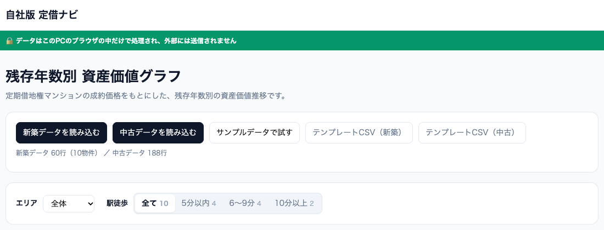

# 勉強会：AIで「自社版 定借ナビ」をつくる

AI・Claude・GitHub をさわったことがない方が、スライドのとおりに進めるだけで、自社の新築・中古データから「残存年数別 資産価値グラフ」を表示するツールを作れるようにする教材です。お手本は [定借ナビ](https://teisha-navi.vercel.app/) です。



## 📁 中身

| ファイル | 内容 |
|---|---|
| [slides.pdf](slides.pdf) | 勉強会スライド（45枚）。ブラウザで開けます |
| [slides.pptx](slides.pptx) | 同じスライドの PowerPoint 版（講師が編集する用） |
| [prompts.md](prompts.md) | **プロンプト集**。各ブロック右上の 📋 ボタンでコピーできます |
| [reference/](reference/) | 講師用の完成見本。プロンプト①〜③を実行すると、ほぼこの形になります |
| `images/` | スライドと README で使う画面イメージ |

👉 スライドをブラウザで見る：https://yibooo.github.io/teisha-PIVOT/study-session/slides.pdf

## 🗺 進め方（約3時間）

| 部 | やること | STEP |
|---|---|---|
| 第1部 準備する | GitHub と Claude のアカウントを作る／Private リポジトリ `teisha-tool` を作る | 1〜4 |
| 第2部 つなぐ | Claude Code（claude.ai/code）と GitHub を連携し、Claude 側・GitHub 側の両方で確かめる | 5〜8 |
| 第3部 作る | プロンプト①〜③を貼り付け → Create PR → Merge → Download ZIP → index.html を開く | 9〜15 |
| 第4部 自社データを入れる | Excel を CSV で保存し、ツールの画面の「新築データを読み込む」「中古データを読み込む」から読み込む | 16〜18 |
| 第5部 困ったとき | うまく動かないとき・見た目を変えたいとき・お客様への説明文を作るときのプロンプト | ─ |

## 🔒 データの取り扱い（いちばん大切なルール）

- 自社の物件データは、**Claude にも GitHub にも渡さない**。データはツールの画面で読み込み、PCのブラウザの中だけで計算します
- 相談するときは **CSV の1行目（列名）だけ** を貼る
- リポジトリは必ず **Private**
- 社内規程とデータ提供元の利用条件に従う

## 📊 CSV の形

**新築データ**（1住戸＝1行）

```text
物件名,区,最寄駅,駅徒歩分,竣工年,借地期限年,総戸数,価格,専有面積
```

**中古データ**（1成約＝1行）

```text
物件名,成約年月,価格,専有面積,階
```

価格は万円、専有面積は㎡、成約年月は `2024/05` の形。2つのデータは「物件名」でつなぎます。

## 🧪 完成見本を動かす（講師向け）

1. このリポジトリを Download ZIP して展開
2. `study-session/reference/index.html` をダブルクリック
3. 「サンプルデータで試す」を押す（サンプルはすべて架空の物件です）

`index.html?demo=1` で開くと、サンプルが自動で表示されます（スライド用のスクリーンショットに使用）。

## 📝 メモ

- Claude Code の画面・GitHub の画面は変わることがあります。スライドの画面はイメージ図です。大きく変わったら、スライドの該当 STEP を更新してください
- スライドとプロンプト集は同じ原本から作っています。プロンプトを直すときは、両方がそろうように更新してください
- スライドの作り直し方は [source/README.md](source/README.md)
